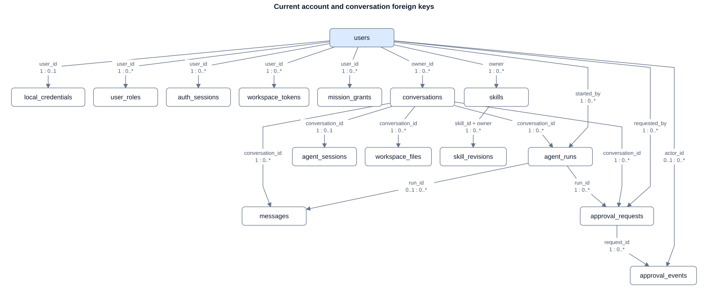
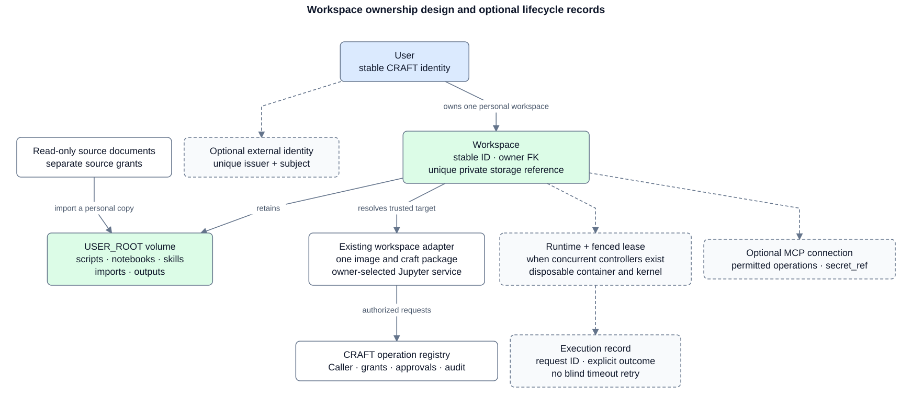

# Identity and workspace ownership

CRAFT uses a stable application user to own conversations, credentials and personal workspaces. Authentication proves that user; a workspace retains their files; a runtime executes their code. These have different lifecycles.

**Decision IAM-01 · 20 October 2026:** retain the existing account and operation systems, establish explicit workspace ownership, and add lifecycle records incrementally. A database constraint preserves a relationship; the operation and service still authorize each request. This decision defines the direction for future migrations. The [table reference](identity.md) distinguishes current storage from the additions below.

## What is standard

There is no standard SQL schema covering users, passwords, workspaces, tools and MCP. OpenID Connect defines login identity, OAuth defines delegated access, SCIM defines provisioning resources, and MCP defines tool communication. Mature systems demonstrate useful relationships rather than one schema to copy.

The common pattern is a stable user with separate credentials, sessions and owned resources. Django supports users, roles and sessions; Ory separates identity traits, credentials and sessions; JupyterHub keeps a user independently of their running server. Their tables and operational responsibilities differ. CRAFT can use the pattern without adopting those frameworks.

| Choice | Benefit | Cost and fit |
|---|---|---|
| Keep local accounts and `argon2-cffi` | Reuses working handlers, password hashing and revocable browser sessions | CRAFT remains responsible for account creation, resets and session policy. Smallest change now |
| Add an external OpenID Connect provider | Delegates login, recovery and MFA to a provider that offers them | Adds provider configuration and a validated login flow. Keep local ownership IDs; link by issuer and subject |
| Adopt an identity platform or JupyterHub | Provides broader identity or user-server lifecycle management | Adds services, deployment and integration work. Choose for concrete lifecycle needs, rather than for a table layout |

OpenID Connect identifies a person by **`(issuer, subject)`**, not email or username. SCIM provisioning is a separate concern. Neither requires replacing CRAFT's user IDs. Keep the existing password library and its hash-upgrade mechanism; SHA-256 is suitable for verifying high-entropy random tokens, not passwords.

## Current boundaries

The account, conversation, agent and approval tables already use user foreign keys. Browser sessions store digests of random tokens with idle expiry, absolute expiry and revocation. Workspace tokens are account-scoped HTTP read capabilities. Agent runs have separate short-lived MCP credentials.

Personal Jupyter storage is outside these SQL tables. The backend currently selects a server, kernel and private MCP connection from a trusted user-to-workspace configuration file. The product interface has its own owner-to-URL configuration. Account creation does not provision a workspace, and SQL does not enforce unique volume or server ownership.

`workspace_files` means **conversation attachments in PostgreSQL**. It does not contain the personal scripts, notebooks, Markdown skills or outputs under `USER_ROOT`. The database also retains a separate saved-skill/revision API, notes and a draft model. Their retirement requires an explicit compatibility and data-migration step; personal Markdown files are the workspace skill source.

The diagram shows selected actual foreign keys. A user can have no credential or conversation. Independent foreign keys do not enforce matching ownership between a run, conversation, message and approval. `call_log` identifiers are correlation metadata without foreign keys.

## Minimal durable workspace model

The first addition is one `workspaces` table:

| Field | Meaning and constraint |
|---|---|
| `id` | Stable UUID primary key; survives server or container replacement |
| `owner_user_id` | Required FK to `users.id`; unique for one personal workspace per user |
| `storage_ref` | Unique, private reference to the owner's durable volume; no credential or user-supplied host path |
| `created_at`, `archived_at` | Creation and reversible deactivation metadata; archiving does not erase files |

Resolve the workspace from the trusted `Caller`, then use one adapter to select its configured service. Reuse `app/infrastructure/workspaces.py`, the existing `app/workspace` handlers/services and Jupyter Contents API. A container ID, kernel ID, endpoint URL, username or token is not the workspace's identity.

Keep `.py`, `.ipynb`, `skills/*.md`, imports and outputs in that workspace's volume beneath `USER_ROOT`. A file's initial identity is its workspace and relative path. Add a file catalog or revision model only when stable links across rename or concurrent editing require it; a catalog must not become a competing copy of file contents. Source documents remain immutable and grant-scoped; importing creates a personal copy outside source ingestion and embeddings.

This is the target relationship model, not an implemented SQL schema. Solid links show the core ownership design; dashed boxes show additions contingent on the features described below. `USER_ROOT` is filesystem storage, not another table.

Workspace children normally need only `workspace_id`: derive the owner through their parent. If a child stores both workspace and user IDs, enforce the pair with a composite foreign key to a unique `(workspace.id, workspace.owner_user_id)`. Use the same mechanism for run/conversation and approval/run relationships where scope is duplicated. CRAFT's `skill_revisions` already demonstrates an owner-preserving composite FK. Required scope columns must be non-null; separate FKs on two IDs allow mismatched pairs.

## Sessions and credentials

| Record or connection | Purpose | Current ending behavior |
|---|---|---|
| `auth_sessions` | Browser login | Current-session logout; all browser sessions revoked on password reset or disable; idle/absolute expiry |
| `workspace_tokens` | Account-scoped HTTP reads from personal Python | Own revoke or expiry; disabled account denied on fresh resolution. Logout and password reset do not revoke these tokens |
| `agent_runs` credential | Active run's calls to CRAFT MCP | Replacement, expiry, pause or run end; account and conversation checked per call. Parent browser session is provenance, not its validity check |
| `agent_sessions` | Saved agent state for a conversation | Replaced as runs save state; not an authentication credential |
| Jupyter login, kernel and connection secret | Direct personal editing and execution | Managed by the separately configured Jupyter service; CRAFT logout does not log out Jupyter |

A lifecycle change must name which credentials it invalidates. Account disable denies fresh CRAFT requests; it is not proof that an already running kernel stopped or a direct Jupyter session ended. Define reset, disable, token revocation, runtime termination and retention as distinct actions. Test each credential class rather than treating every “session” as equivalent.

Inbound random bearer credentials can be stored as one-way verifiers. Outbound connector access/refresh credentials must be recoverable to call the provider: store a protected secret reference, with rotation and expiry metadata, rather than a token digest or public configuration. Never pass CRAFT's browser or run credential through to an external MCP server.

## Tools, MCP and code

The operation registry remains the authoritative definition of tool names, argument shapes, access and effects. HTTP, CRAFT MCP and the Python package reuse that boundary for authorization, validation, errors and metadata logging. User input and tool annotations cannot supply the trusted user or grant access. Personal skills contain instructions and references to workspace files; MCP need not store another copy of them.

If users configure external connectors, add workspace-owned `mcp_connections` containing non-secret provider metadata, permitted operations and `secret_ref`. Add grants or tool tags when selection/sharing requires them; do not duplicate executable tool schemas in SQL. Tool discovery is not authorization.

CRAFT currently uses a first-party run credential for its own MCP transport. General external HTTP MCP interoperability is a separate integration: the current MCP authorization specification requires protected-resource discovery, appropriate OAuth resource/audience checks and per-request token validation. This decision does not claim that CRAFT already implements that federated flow. Use authorization code with PKCE for applicable OAuth login flows; the resource-owner password grant is prohibited by the OAuth security BCP.

## Runtime and execution lifecycle

Retain one workspace image and package across chat and direct Python entry points. Keep durable storage separate from disposable containers and kernels. The current in-process runtime ownership guard is not a distributed workspace lease. PostgreSQL already coordinates agent-run creation with a transaction advisory lock, but does not provide a durable kernel lease or stale-run recovery automatically.

Add a workspace runtime record and fencing lease before multiple controllers can launch, replace or execute in the same workspace. Claim under a short transaction, dispatch outside it, renew a bounded lease and reject stale owners. Preserve paused human approvals independently of process lifetime. A queue is useful for durable scheduling, quotas or multiple executors; it is unnecessary solely to create a user-to-workspace FK. Use the existing PostgreSQL and process lifecycle seams before introducing another broker or orchestration framework.

Current approved external actions record `executed` before dispatch. That records consumption of the approval, not successful code completion. A crash before dispatch or a lost response can leave an unknown outcome. A future execution record needs a stable request ID and explicit claimed, dispatched, succeeded, failed or unknown state. Do not automatically retry code or file writes after an ambiguous timeout. Interrupting a timed-out kernel and preventing stale writes need separate tests. File replacement also needs revision conflict detection before concurrent user and agent editing is supported.

## Implementation and regression gates

Implement each row as a separate verified change. The tests in this table are requirements for those changes, not assertions that they exist today. Extend the current account, agent, approval and workspace test suites instead of building a second authorization framework.

| Step | Smallest deliverable | Required evidence |
|---|---|---|
| 1. Pin existing behavior | Credential-lifecycle matrix and current ownership regressions | Two accounts: foreign conversations, approvals and tokens denied; all credential expiry/revoke/reset/disable cases; current API shapes unchanged |
| 2. Establish ownership | `workspaces` migration and one owner resolver | Disposable PostgreSQL: orphan owner, duplicate owner/volume and mismatched scoped child rejected; idempotent account backfill preserves files; two-account endpoint/volume separation |
| 3. Join entry points | HTTP, MCP, Python and direct workspace use the same resolved owner | No request or model argument selects another owner/server; imported source remains unchanged; restart preserves scripts, notebooks, skills and outputs |
| 4. Coordinate execution | Runtime lease and explicit external outcome when concurrent controllers are introduced | Two-controller claim conflict, lease expiry and fencing, crash before/after dispatch, unknown timeout, no blind mutation replay, kernel interruption and edit conflict behavior |
| 5. Add integrations | External identity or MCP connection only when required | `(issuer, subject)` uniqueness, account-link ownership, wrong audience/scope rejected, cross-user secret isolation and credential rotation |
| 6. Retire duplicate models | Explicit notes/drafts/database-skills and attachment compatibility migration | Inventory real callers and retained data; export/import parity, rollback and no volume deletion on conversation archive |

For each migration, run `alembic upgrade head` and `alembic check` against a disposable PostgreSQL database. Exercise invalid inserts directly to prove FK, uniqueness and lifecycle constraints; API-only tests cannot prove database integrity. Test authorization separately through supported transports and actual owner-isolated Jupyter services. Document retained history, purge privileges, FK indexes and rollback. Do not cascade account deletion into a personal volume by accident.

PostgreSQL row-level security is an optional additional boundary. It needs an application role that cannot bypass it and verified connection-pool identity handling. Table owners and privileged roles can bypass policies. It does not replace the existing trusted-caller checks.

## Maintaining the decision

Every change to these invariants must update this decision and the table reference in the same PR as its migration and tests. A departure must record the reason, alternatives, authorization and lifecycle impact, migration/backfill, rollback and verification. API-contract changes require specific approval. A documentation snapshot or a test that merely repeats table names does not prove ownership or revocation.

## Sources

Official sources accessed 20 October 2026. Protocol rules, framework examples and the CRAFT design above have different authority.

- [OpenID Connect Core 1.0, §5.7](https://openid.net/specs/openid-connect-core-1_0.html#ClaimStability): issuer/subject identity stability.
- [SCIM Core Schema, RFC 7643, §§3.1–4](https://www.rfc-editor.org/rfc/rfc7643): provisioning IDs and User/Group resources.
- [OAuth security BCP, RFC 9700, §§2.4, 4.14](https://www.rfc-editor.org/rfc/rfc9700): password-grant prohibition and refresh-token protections.
- [MCP authorization, 2026-07-28](https://modelcontextprotocol.io/specification/2026-07-28/basic/authorization): protected resources, discovery, audience and credential boundaries.
- [OWASP password storage](https://cheatsheetseries.owasp.org/cheatsheets/Password_Storage_Cheat_Sheet.html) and [session management](https://cheatsheetseries.owasp.org/cheatsheets/Session_Management_Cheat_Sheet.html): maintained password hashing and server-enforced session lifecycle.
- [Django 6.0 authentication](https://docs.djangoproject.com/en/6.0/ref/contrib/auth/) and [sessions](https://docs.djangoproject.com/en/6.0/topics/http/sessions/): framework conventions, not a workspace schema.
- [Ory identities](https://www.ory.com/docs/kratos/manage-identities/overview) and [sessions](https://www.ory.com/docs/kratos/session-management/overview): identity/credential/session separation.
- [JupyterHub User](https://jupyterhub.readthedocs.io/en/stable/reference/api/user.html) and [Spawner](https://jupyterhub.readthedocs.io/en/stable/reference/api/spawner.html): persistent users and managed runtime state.
- [PostgreSQL 18 constraints](https://www.postgresql.org/docs/18/ddl-constraints.html) and [row security](https://www.postgresql.org/docs/18/ddl-rowsecurity.html): composite ownership FKs, null behavior, indexes and policy limitations.

Implementation evidence: [accounts](https://github.com/mchdeore/CRAFT/blob/main/app/accounts/storage.py), [identity resolution](https://github.com/mchdeore/CRAFT/blob/main/app/infrastructure/access.py), [workspace selection](https://github.com/mchdeore/CRAFT/blob/main/app/infrastructure/workspaces.py), [agent storage](https://github.com/mchdeore/CRAFT/blob/main/app/agent/storage.py), [approval execution](https://github.com/mchdeore/CRAFT/blob/main/app/approvals/service.py), [operation registry](https://github.com/mchdeore/CRAFT/blob/main/app/infrastructure/operations/registry.py) and [migration history](https://github.com/mchdeore/CRAFT/tree/main/app/infrastructure/database/migrations/versions).

## Table reference

The current main application declares 34 PostgreSQL tables through 15 Alembic migrations. This reference describes declared schema, not a live database inspection. [Identity and workspace ownership](identity.md) records decision IAM-01 and the migration/test sequence.

### Accounts, conversations and personal ownership

| Table | Key and relationship | Responsibility |
|---|---|---|
| `users` | UUID PK; unique lowercase username | Durable local identity, display name and disable state |
| `local_credentials` | User PK/FK | At most one local password hash per user |
| `user_roles` | `(user_id, role)` PK; user FK | Current `member`/`admin` grants |
| `auth_sessions` | UUID PK; user FK; unique token digest | Expiring, revocable browser login |
| `workspace_tokens` | UUID PK; user FK; unique 32-byte token digest | Account-scoped HTTP read credentials |
| `mission_grants` | UUID PK; user FK; unique user/mission/silo | Source access; mission/silo strings do not have catalog FKs |
| `conversations` | UUID PK; owner FK | Chat title, timestamps and archive state |
| `messages` | UUID PK; conversation FK; optional run FK; unique conversation/sequence | Append-only history |
| `agent_runs` | UUID PK; conversation and starter FKs | Run status and temporary MCP credential |
| `agent_sessions` | Conversation PK/FK | Saved agent framework state |
| `approval_requests` | UUID PK; run, conversation and requester FKs | Frozen operation, arguments and digest |
| `approval_events` | UUID PK; request FK; optional actor FK | Append-only decisions and execution consumption |
| `call_log` | Numeric PK; correlation IDs without FKs | Operation metadata and outcome, including workspace-token ID |
| `workspace_files` | UUID PK; conversation FK; optional export-approval FK | SQL chat attachments and generated charts; not Jupyter personal files |
| `notes` | UUID PK; owner FK; optional conversation FK | Existing owner-scoped note API |
| `drafts` | UUID PK; owner, optional parent/approval FKs | Declared draft storage |
| `skills` | UUID PK; owner FK; unique ID/owner | Existing database saved-skill API |
| `skill_revisions` | Skill/revision PK; composite skill/owner FK; unique owner/mutation ID | Owned immutable saved-skill revisions |

The current [account diagram](images/identity-current.svg) shows the core FKs. The database enforces the skill/revision owner pair. Other independent owner/conversation/run FKs require service checks to prevent scope mismatch. A primary key identifies a row; it grants no request permission.

### Source library and datacube

Personal files and their skills are not stored or embedded in these source tables.

| Table | Key and relationship | Responsibility |
|---|---|---|
| `provider_items` | Source item PK; mission/silo/stage strings without FKs | Source catalog and withdrawal state |
| `doc_versions` | UUID PK; item FK; unique item/version | Indexed source version, hash and summary |
| `chunks` | UUID PK; cascading version FK; unique version/block | Derived searchable source blocks |
| `vectors` | UUID PK; polymorphic owner kind/ID without FK | Derived chunk/version/facet embeddings |
| `version_diffs` | From/to/sequence PK; cascading version FKs | Derived version comparisons |
| `index_cursor` | Provider PK | Source indexing progress |
| `silos` | Vocabulary key PK | Controlled source domain |
| `stages` | Vocabulary key PK | Controlled source lifecycle stage |
| `missions` | Mission key PK; current-stage FK | Source mission |
| `mission_aliases` | Alias PK; mission FK | Mission lookup names |
| `elements` | UUID PK; mission, silo and optional parent FKs | Mission/silo-specific element |
| `parameters` | Parameter key PK | Quantity, units and validity range |
| `unit_conversions` | Parameter/unit PK; parameter FK | Quantity unit conversion |
| `header_synonyms` | Header/parameter PK; parameter FK | Table-header recognition |
| `cube_values` | UUID PK; mission/silo/stage/element/parameter/approval FKs | Accepted observations with source provenance |
| `facet_texts` | UUID PK; mission FK; unique mission/facet | Derived mission-facet text and source references |

Arrows name actual FK columns. `vectors` owner references, `facet_texts` source arrays and cube item/version/block provenance are not FK-enforced. Their consistency and deletion need explicit source-index handling; the diagram does not imply authorization or semantic accuracy.

### Outside the current SQL schema

| Component | Current authority | Planned relationship |
|---|---|---|
| Personal workspace | Trusted private user-to-service configuration | Stable `workspaces.owner_user_id → users.id`, unique owner and storage reference |
| Scripts, notebooks, Markdown skills and outputs | Owner's Jupyter Contents API and durable `USER_ROOT` volume | Remain workspace contents; optional identity/revision catalog when required |
| Container, kernel and native bridge binding | Configured service and in-process runtime state | Workspace-owned runtime/lease when concurrent controllers require it |
| Executable tools | Code operation registry | Reuse registry; store only necessary user/workspace grants or connector metadata |
| External MCP connection credentials | Private service configuration | Workspace-owned connection with protected secret reference and lifecycle |
| External login | `users.idp_tenant_id` and `users.idp_object_id`, unique together, set at the first craft-id sign-in; unknown people wait in `access_requests` | Kept: craft-id uses Entra ID's `tid`/`oid` claims |

Schema sources: [shared metadata](https://github.com/mchdeore/CRAFT/blob/main/app/infrastructure/database/metadata.py), [accounts](https://github.com/mchdeore/CRAFT/blob/main/app/accounts/storage.py), [conversations](https://github.com/mchdeore/CRAFT/blob/main/app/conversations/storage.py), [agent](https://github.com/mchdeore/CRAFT/blob/main/app/agent/storage.py), [approvals](https://github.com/mchdeore/CRAFT/blob/main/app/approvals/storage.py), [audit](https://github.com/mchdeore/CRAFT/blob/main/app/infrastructure/operations/storage.py) and [migrations](https://github.com/mchdeore/CRAFT/tree/main/app/infrastructure/database/migrations/versions).
