# 8. Engineering datacube

The application programming interface (API) uses Hypertext Transfer Protocol (HTTP) and JavaScript Object Notation (JSON). Tool calls use the Model Context Protocol (MCP). Identifiers are universally unique identifiers (UUIDs), and times use Coordinated Universal Time (UTC). Content hashes use the 256-bit Secure Hash Algorithm (SHA-256). Schema blocks use Structured Query Language (SQL). Spreadsheet files use the Excel format (xlsx) or comma-separated values (CSV); text files use Markdown, Hypertext Markup Language (HTML) or Portable Document Format (PDF).

## 8.1 Purpose

The engineering datacube answers engineering questions about missions from cited sources. It finds documents and passages, finds missions by their parameters, compares missions and finds similar ones, in chat and in the browser. Every result carries a citation that can be checked against the original.

The datacube runs on labelled simulated data. Every mission, document and value carries the simulated label.

## 8.2 Parts

| Part | Holds | Owns the truth for | Rebuildable |
|---|---|---|---|
| Document provider | The original files and every version of them | What a document says | No; it is the source |
| Library | Text chunks, summaries, facet texts, vectors and version differences | Nothing; it mirrors the provider | Yes, from the provider |
| Cube | Missions, silos, stages, elements, the parameter dictionary and approved values | What CRAFT has accepted as a mission's parameters | No; approvals are records |

The library and cube never store provider original bytes. The local provider folder stores generated originals and immutable versions; application operations read them when indexing, checking a citation or opening a preview. Document content changes enter through the provider command line, and indexing records the new version and differences.

## 8.3 Document provider

The provider is a folder on disk with a sidecar record. The setting `CRAFT_PROVIDER_ROOT` names the folder. A document's path says where it belongs.

```text
<provider root>/
  missions/
    msn-sim-01/
      requirements/st2-definition/system-requirements.md
      engineering/st3-design/power-budget.xlsx
  reference/
    glossary.md
  .provider/
    items.jsonl            one line per item: identifier, path, title, labels, versions
    changes.jsonl          the change feed, one numbered line per change
    versions/<item>/<n>    the bytes of every version
```

| Path part | Meaning | If missing or unknown |
|---|---|---|
| `missions/<mission key>` | The mission | The file is reference material, readable by every account |
| `<silo>` | One of the six silos in section 8.8 | The file belongs to the mission only |
| `<stage>` | One of the stage keys in section 8.8 | The file has no stage |

| Concept | Rule | Example |
|---|---|---|
| Item | `itm_` and 12 lowercase hexadecimal characters, assigned when the file is first seen. A move or rename keeps it | `itm_4f9c2a0b1c2d` |
| Version | Numbered from 1. Every content change makes a new version. Old versions stay readable; each new version records its original filename and media type | `itm_4f9c2a0b1c2d` version 3 |
| Content hash | SHA-256 of the version's bytes | `sha256:9b1e…` |
| Move | Same item, new path. A file that vanished and a new file with the same hash in one scan are one move | Path changes; item and versions stay |
| Delete | The item is marked deleted. Its versions stay | `deleted_at` is set |
| Labels | `simulated` and `classification` (`unclassified`, `protected-a`, `protected-b`) from `items.jsonl`; new items are simulated and unclassified | |

The provider offers six functions. CRAFT's indexing and preview use the first four. People and demo scripts use the last two through the command line.

| Function | Does | Never does |
|---|---|---|
| `scan()` | Compares the folder with `items.jsonl` and appends added, changed, moved and deleted items to the change feed | Change a document |
| `list_changes(cursor)` | Returns up to 500 changes after the cursor and the new cursor | Return file contents |
| `get_item(item)` | Returns path, title, labels, the deleted flag and the version list | Return another item |
| `read_content(item, version)` | Returns the bytes of that version | Return another version |
| `write_content(path, bytes)` | Writes the file and records a new version | Get called by an operation |
| `delete_item(item)` | Removes the file and marks the item deleted | Erase a version |

The command line wraps them: `craft provider scan`, `craft provider put <path> <file>`, `craft provider rm <path>` and `craft provider log`.

## 8.4 Library: chunks, summaries and citations

| Kept | Why | Not kept |
|---|---|---|
| Item, version, hash, path, tags and labels | Stable citations and moved files | Original bytes |
| Chunks: ordered text and table blocks with locators | Verbatim quotes, keyword and vector search | Page images |
| One summary per document version | Fast scanning before reading chunks | Model reasoning |
| Facet texts per mission (section 8.7) | Similar missions | Uncited facet text |
| One vector per chunk, document version and facet text | Semantic search | A vector without its model and recipe |
| Block differences between versions | What changed | A full copy of each version |

One converter turns each allowed format into chunks. A format not listed is refused with a reason. A PDF without a text layer is refused with the reason `no text layer`.

| Format | One chunk is | Locator |
|---|---|---|
| Markdown, plain text, HTML | The paragraphs under one heading, split at about 300 words. Scripts are removed from HTML | `heading=2.3;block=4` |
| Word (docx) | The paragraphs under one heading, split at about 300 words | `heading=2.3;para=4` |
| PDF with a text layer | The text of one page, split at about 300 words | `page=4;block=2` |
| PowerPoint (pptx) | One slide with its speaker notes | `slide=7` |
| Excel (xlsx), CSV | One table region per sheet: its header row and up to 30 rows. Literal cell values only; formulas, macros and links never run | `sheet=Power;range=A4:D9` |
| A table in any other format | Its header row and up to 30 rows; the header repeats when the table is split | the format's locator plus `;rows=1-30` |

Tables use pipe-delimited rows with repeated headers. Cell line breaks become spaces; literal pipes and backslashes are escaped. A spreadsheet range names the source table region, and `rows` identifies its data-row window.

Each chunk keeps three text fields: `text` (the words exactly as in the source), `heading_path` (the headings above it, such as `2 Power > 2.3 Margins`, or the slide title, or the sheet name) and `locator`.

Each document version has one summary of at most 150 words, made by one model call and labelled `generated`. With the fake model (section 4), the summary is the first 150 words of the document, labelled `extract`.

A citation handle names everything needed to show and re-check a quote. It survives a rebuild of the library; chunk identifiers do not.

```json
{"item": "itm_4f9c2a0b1c2d", "version": 3, "block": 12, "locator": "page=4;block=2",
 "quoteSha256": "c41d…", "simulated": true}
```

`block` is the chunk's position in its document version, from 1. `quoteSha256` is the SHA-256 of the quoted text. A value's citation adds `;row=N` to the locator and hashes that row's text.

## 8.5 Tables, tags and embeddings

Tags filter; embeddings rank. Mission, silo and stage tags come from the provider path and are copied to each document version and chunk. Tags are never embedded.



Thick blue arrows go into `vectors`: chunks, document versions and facet texts are the only embedded records. Access grants (section 8.15) are not shown.

| Record | Tags | Embeddings | What is embedded |
|---|---|---|---|
| Chunk | Mission, silo, stage, simulated, from its document | 1 | `chunk-v1`: title, heading path and text |
| Document version | Mission, silo, stage from the path; simulated and classification from the provider | 1 | `doc-v1`: title and summary |
| Facet text | Mission and facet | 1 | `facet-v1`: the facet text |
| Mission | Simulated; current stage | None; its facet texts carry its vectors | |
| Cube value | Mission, silo, stage | None; found by filters and by the chunk it cites | |

Vectors have 1536 dimensions and use cosine distance. The embedding model is the one in section 4. With the fake model, vectors are the deterministic fake embeddings.

Section 7 defines the library tables in migration 0006: `provider_items`, `doc_versions`, `chunks`, `vectors`, `version_diffs`, `index_cursor` and `mission_grants`. The cube tables follow.

```sql
-- 0009_create_missions                             craft_app: SELECT (seed and command line write as craft_owner)
create table silos (key text primary key, label text not null, seq int not null unique);
create table stages (key text primary key, label text not null, seq int not null unique,
  gate text not null);
create table missions (key text primary key check (key ~ '^msn-[a-z0-9-]{1,40}$'),
  title text not null, current_stage text not null references stages,
  simulated boolean not null, created_at ts);
create table mission_aliases (alias text primary key check (alias = lower(alias)),
  mission_key text not null references missions);
create table elements (id, mission_key text not null references missions,
  silo text not null references silos, name text not null, parent_id uuid null references elements,
  unique (mission_key, silo, name));

-- 0010_create_values                               cube_values: INSERT, SELECT only
create table parameters (key text primary key check (key ~ '^[a-z][a-z0-9_]{1,40}$'),
  label text not null, unit text not null, min_value numeric null, max_value numeric null,
  whole boolean not null default false);
create table unit_conversions (parameter text references parameters, unit text not null,
  multiplier numeric not null, value_offset numeric not null default 0,
  primary key (parameter, unit));                         -- the standard unit has multiplier 1
create table header_synonyms (header text check (header = lower(header)),
  parameter text references parameters, language text not null check (language in ('en','fr')),
  primary key (header, parameter));
create table cube_values (id, mission_key text not null references missions,
  silo text not null references silos, stage text null references stages,
  element_id uuid null references elements, parameter text not null references parameters,
  kind text not null check (kind in ('exact','range','unknown','not_applicable')),
  low numeric null, high numeric null, source_number text null, source_unit text null,
  valid_from date not null, recorded_at ts,
  item text not null, version int not null, block int not null, locator text not null,
  quote_sha256 bytea not null check (octet_length(quote_sha256) = 32),
  approval_request_id uuid null references approval_requests, simulated boolean not null,
  check ((kind in ('exact','range') and low is not null and high is not null)
    or (kind in ('unknown','not_applicable') and low is null and high is null)),
  check (kind <> 'exact' or low = high), check (low is null or low <= high));
create index on cube_values (mission_key, parameter, valid_from desc, recorded_at desc);
-- seeded values have no approval request; every other value names the request that accepted it

-- 0011_create_facet_texts                          craft_app: SELECT (indexing writes as craft_owner)
create table facet_texts (id, mission_key text not null references missions,
  facet text not null check (facet in ('purpose','design','operations','program','cost_and_risk')),
  text text not null, sources text[] not null, model text not null, built_at ts,
  unique (mission_key, facet));
```

## 8.6 Indexing and changes

`craft index` brings the library up to date. It runs as `craft_owner`, like the seed, because the library is derived data.

1. Scan the provider.
2. Read the change feed after the stored cursor.
3. For each new version: convert it to chunks, write the summary, embed chunks and the document version, and record the block differences from the previous version by chunk text hash.
4. For each move: update the item's path and tags. For each delete: mark the item deleted.
5. Rebuild the facet texts and facet vectors of every mission whose documents changed.
6. Store the new cursor.

Block matching preserves repeated text. Equal hashes at the same position are unchanged; remaining equal hashes pair in ascending position order and are moved. Remaining pairs at the same position are changed; unmatched blocks are added or removed. Differences are stored with the new version in the same transaction.

Running `craft index` twice in a row adds nothing. `craft index --rebuild` empties the library tables and indexes every version of every item again; cube values and their citations are untouched.

| Change in the provider | Library | Cube |
|---|---|---|
| Content edited | New document version with its chunks, vectors, summary and block differences. The old version stays for existing citations | Values citing the old version keep citing it. A changed table can be read again for new candidate values (section 8.14) |
| Moved to another mission, silo or stage folder | Same item; tags updated | Values keep their mission |
| Renamed | Same item; title updated | None |
| Deleted | Versions stay for existing citations; the item leaves search | A value citing it shows `unknown, source withdrawn` (section 8.10) |

Search covers the latest version of each item that is not deleted. Older versions are reached through citations, `read_chunks` and `compare_versions`.

## 8.7 Facets

A facet is one way of describing a mission. Each mission has at most one facet text per facet. A facet text has about 80 words.

| Facet | Covers | Fed mostly by silos |
|---|---|---|
| `purpose` | What the mission is for, its users and payload | requirements, reviews |
| `design` | The spacecraft: mass, power, thermal, structure, communications | engineering, requirements, quality |
| `operations` | Orbit, launch, ground segment and operations | launch, engineering |
| `program` | Schedule, stages, reviews and decisions | reviews, requirements |
| `cost_and_risk` | Estimates, contingency and risks | budget, reviews |

One model call per mission reads the summaries of the mission's documents and writes the facet texts. Each sentence ends with the item it came from in square brackets, such as `[itm_4f9c2a0b1c2d]`. A validator removes any sentence that names no item or names an item outside the mission. A facet with no remaining sentence has no row and counts as missing, never as zero. `sources` lists the items the facet text names.

With the fake model, each facet text is the first sentence of each document summary whose silo feeds that facet first in the table above: requirements feeds `purpose`, engineering and quality feed `design`, launch feeds `operations`, reviews feeds `program` and budget feeds `cost_and_risk`.

Facet texts use active sources and their latest indexed summaries, with at most 80 words per facet. Changed versions, moves and withdrawals rebuild the affected missions. Each text has a `facet-v1` vector labeled with the embedding model. Reads recheck every cited source against indexed and live mission and silo grants. A withdrawn source, changed mission or missing current-model vector cannot contribute to a similarity score. Read operations make no conversational model call.

## 8.8 Missions, silos and stages

| Record | Holds | Example |
|---|---|---|
| Mission | Key, title, current stage, simulated label | `msn-sim-01`, current stage `st3-design` |
| Mission alias | Another name a source uses for the mission | `sim-01` maps to `msn-sim-01` |
| Element | A named part of a mission within a silo, with an optional parent | power subsystem in `engineering` |

| Silo | Holds |
|---|---|
| `requirements` | What the mission must do |
| `quality` | How it is verified and assured |
| `launch` | Launch and orbit |
| `engineering` | How it is built |
| `reviews` | Reviews and decisions |
| `budget` | Costs and estimates |

Stages are the mission lifecycle. Each mission points at its current stage. A stage key never changes meaning.

| Key | Stage | The stage ends when | Typical documents |
|---|---|---|---|
| `st1-concept` | Concept | The mission need and options are agreed | Need statements, concept studies |
| `st2-definition` | Definition | System requirements are baselined | Requirements, interface drafts |
| `st3-design` | Design | The design review passes | Design documents, mass and power budgets |
| `st4-build` | Build | Units are built and integrated | Build records, procurement records |
| `st5-verification` | Verification | The test campaign is complete | Test plans and reports |
| `st6-operation` | Operation | The mission ends | Operations and anomaly reports |
| `st7-closure` | Closure | Disposal and lessons are recorded | Close-out reports |

The seed sets each mission's current stage. `craft missions stage <mission key> <stage key>` changes it and runs as `craft_owner`. A query can ask for the current stage of each mission with the stage `current`.

## 8.9 Parameter dictionary and units

Each parameter has a key, a label, a standard unit, allowed bounds and whether it is whole. Other units convert to the standard unit on intake with `standard = source × multiplier + offset`.

| Key | Label | Standard unit | Allowed | Converts from |
|---|---|---|---|---|
| `mass_dry` | Dry mass | kg | 0 or more | g, t, lb |
| `power_peak` | Peak power | W | 0 or more | kW, mW |
| `payload_volume` | Payload volume | m3 | 0 or more | L, cm3 |
| `orbit_altitude` | Orbit altitude | km | 0 or more | m |
| `readiness` | Technology readiness | level | 1 to 9, whole | none |
| `design_life` | Design life | year | 0 or more | month |

1. The source number, its unit and the conversion are kept beside the converted value.
2. No unit, no value. A number without a unit is shown as a problem.
3. A unit is never guessed from the size of a number.
4. A key never changes meaning. A new meaning gets a new key.
5. A header synonym maps a source header, lower-cased with its unit in parentheses removed, to a parameter. "Masse sèche (kg)" maps to `mass_dry` with unit kg.

## 8.10 Values and state on a date

| Field | Meaning | Example |
|---|---|---|
| Mission, silo, stage, element | Where the value belongs | `msn-sim-01`, `engineering`, `st3-design`, power subsystem |
| Parameter | Dictionary key | `power_peak` |
| Kind | `exact`, `range`, `unknown` or `not_applicable` | `exact` |
| Low, high | The value in the standard unit; equal for an exact value | 450, 450 |
| Source number and unit | As written in the source | `0.45`, `kW` |
| Valid from | The date the source says the value applies from | 2026-03-01 |
| Recorded at | When CRAFT accepted it | 2026-10-15 14:02 UTC |
| Citation | Item, version, block, locator and quote hash (section 8.4) | |
| Approval | The approval request that accepted it; none for seeded values | |
| Simulated | The simulated label | true |

A value exists only after a person approved it, or the seed loaded it. Values are append-only. Unknown and not applicable are never zero.

The logical cell is mission, silo, stage, element and parameter. A state request gives `at` (a date) and `knownAt` (a time); both default to the time of the request and are returned with the result.

| Behavior | Does | Never does |
|---|---|---|
| Pick the value | In each logical cell, takes the value with the latest `valid_from` not after `at`, among values recorded at or before `knownAt`. A tie goes to the latest `recorded_at`, then the highest identifier | Average or merge two values |
| Source withdrawn | If the picked value's item is deleted in the provider, shows `unknown, source withdrawn` | Fall back to an older value |
| Unknown replaces a number | A later `unknown` value wins over an older number | Keep showing the old number |

Example: peak power 400 W valid from 1 January (version 1) and 450 W valid from 1 March (version 2). On 15 February the state is 400 W citing version 1. On 15 March it is 450 W citing version 2. On 15 March after the item is deleted, it is `unknown, source withdrawn`.

## 8.11 Library search and exploration

`search` runs the section 10 hybrid search over chunks and document summaries.

1. Access first (section 8.15), then the mission, silo, stage and kind filters.
2. Keyword and vector candidates, 50 each, fused with the normalized 0.7 semantic and 0.3 lexical weights.
3. At most two chunks from the same document section (heading path) in the results.
4. Up to 8 results. Each chunk result carries the chunk before and after it in block order.

`explore` widens the window around a chunk: up to 10 blocks before and after, in the same document version. With a query, the window's chunks are returned with their scores against it.

| Operation | Does | Never does |
|---|---|---|
| `search` | Ranks chunks and document summaries within the filters and returns citation handles | Return text the caller cannot read |
| `get_document` | Returns a document version's tags, labels, summary, outline and version list | Return the original bytes |
| `read_chunks` | Returns up to 20 consecutive chunks of one document version | Return chunks from another version |
| `explore` | Returns the chunks around a handle | Leave the handle's document version |
| `check_citation` | Re-reads the cited version from the provider and compares the quote hash. Returns `current`, `changed`, `newer_version` or `withdrawn` | Change a stored chunk |
| `compare_versions` | Lists blocks added, removed, changed or moved between two versions | Write a merged document |
| `preview` | Streams the original at the cited version, opened at the locator; HTTP only | Store the bytes in CRAFT |
| `download` | Streams the original at a version as an attachment; HTTP only | Store the bytes in CRAFT |

Version comparisons return at most 500 differences, with a truncation flag. Consecutive comparisons use stored differences; other pairs use the same hash rules on demand. Equal versions have no differences. Missing versions are not found.

Citation checks read the exact provider version after both indexed and live mission access pass. Live deletion gives withdrawn. The freshly converted block or cited table row supplies the quote hash; a missing or mismatched quote gives changed. A matching older quote gives newer_version, including versions not yet indexed. The result includes the latest provider version. Cached chunks remain untouched.

## 8.12 Parametric search, comparison and evidence

| Operation | Does | Never does | Example |
|---|---|---|---|
| `list_parameters` | Returns the dictionary with units and conversions | Guess a key | Before a numeric filter |
| `list_missions` | Resolves names and aliases to readable missions, with their current stages | Count hidden missions | "sim-01" |
| `find_missions` | Filters missions by 1 to 12 parameter conditions joined with AND, at a date. Up to 20 results | Match an unknown value; run a free-form query | Dry mass at most 150 kg and orbit at most 600 km |
| `get_mission` | Returns a mission's values at a date, with gaps shown | Fill a gap | `msn-sim-01`, engineering, current stage |
| `compare_missions` | Puts 2 to 5 missions side by side for the same parameters and scope | Compare different elements as if equal | Two missions, mass and power |
| `get_value_evidence` | Returns a value's citation, quote, source number, unit, conversion and citation status | Return an unreadable source | The 450 W value |

A condition names a parameter, an operator (`eq`, `ge`, `le` or `between`), a value and its unit. Values and units convert before the query is built. An unknown value never matches. A range matches only if its whole interval satisfies the condition.

All conditions match within one mission, silo, stage and element. Comparison uses a mission aggregate when present. Otherwise, elements must have the same name and silo. An ambiguous selection is a gap.

## 8.13 Similar missions

`similar_missions` ranks readable missions by their facet texts.

1. Readable missions are selected (access first).
2. For each chosen facet (all five by default), the cosine similarity between the two missions' facet vectors.
3. A facet counts only if both missions have it and the caller can read every item its facet text names.
4. The score is the mean over the facets that count. A pair with fewer counting facets than half the chosen facets, rounded up, is listed as not comparable.
5. Comparable missions are sorted by score, highest first, then by key. Not comparable missions follow. At most 10 results; 5 by default.

`explain_similarity` returns, for each chosen facet, the score and both facet texts with the items they name.

Facet selections contain one to five distinct names. Missing or unreadable facet texts return a null side and no source identifiers. Missing, zero or nonfinite vectors produce a null score. Cosine scores preserve negative values; the mean includes only the facets available on both sides.

| Mission | Score | design | operations | cost_and_risk |
|---|---|---|---|---|
| `msn-sim-04` | 0.86 | 0.91 | 0.88 | 0.79 |
| `msn-sim-07` | 0.71 | 0.80 | 0.62 | missing |

## 8.14 Intake and approval

| Step | Approval | Why |
|---|---|---|
| Library indexing | None | Derived from the provider and rebuildable |
| Candidate values from a table chunk (`prepare_values`) | None | A read: nothing is written |
| Values into the cube (`submit_values`) | The requester approves the batch | The cube is CRAFT's accepted record |
| Seeded values | None; loaded as simulated | Demonstration data |

`prepare_values` reads one table chunk. Each header maps to a parameter through the header synonyms. Each cell becomes a candidate with its row citation, source number and unit, converted value and any problem. The mission comes from the chunk's tags unless the request names it. Problems: unknown header, no unit, unknown unit, not a number, outside the allowed bounds, mission not resolved, no valid-from date.

Parameter headers keep their explicit unit in parentheses; an inline cell unit takes precedence. Recognized parameter headers are converted in every column. Other first columns label rows, and known element columns can contain parameter-labelled rows. Explicit mission-total rows have no element; other element names stay named. Element lookup applies every mission and silo grant, including unspecified scope.

Each candidate has at most one problem, in the order above. The response lists all applicable context problems. Missing mission and date remain visible; a date is never guessed from another block. Empty cells and TBD are unknown, and n/a is not applicable. Numeric bounds use the registered Decimal conversion, bounds and whole-number rule. The row citation preserves escaped source text and its absolute spreadsheet row or table-window row. Nothing is written.

`submit_values` takes the candidates without problems. The approval card shows each candidate's source cell, original number and unit, converted value, mission, element and date. After approval, the values are written in one transaction, each naming the approval request.

## 8.15 Access

| Rule | Applies to |
|---|---|
| Every account, including an admin, needs mission grants for cube reads. A grant in `mission_grants` with a silo covers that silo only; a grant without one covers every silo | Every library and cube operation |
| Reference material (no mission) is readable by every account; an admin reads everything | Library |
| A chunk, document version or value is readable only if its mission and silo are readable | Library and cube |
| Access applies before filtering, ranking and counting | Search, find, compare, similar |
| Results never say how many hidden items were removed | Every list |

`craft users grant <username> <mission key> [--silo <silo>]` and `craft users revoke` change grants.

## 8.16 Operations and tools

Every operation below is declared with `@operation` (section 5) and serves HTTP, the command line and Python. Every one with a tool name is also an MCP tool through the adapter in section 3.3; no list of tools is kept by hand. Reads have the effect `NONE`. Read tools run no conversational model; embedding steps remain private.

| Operation | Route | Tool | Effects |
|---|---|---|---|
| `library.search` | `POST /api/library/search` | `search` | `NONE` |
| `library.get_document` | `GET /api/library/documents/:item` | `get_document` | `NONE` |
| `library.read_chunks` | `GET /api/library/documents/:item/chunks` | `read_chunks` | `NONE` |
| `library.explore` | `POST /api/library/explore` | `explore` | `NONE` |
| `library.check_citation` | `POST /api/library/citations/check` | `check_citation` | `NONE` |
| `library.compare_versions` | `GET /api/library/documents/:item/compare` | `compare_versions` | `NONE` |
| `library.preview` | `GET /api/library/documents/:item/preview` | | `NONE` |
| `library.download` | `GET /api/library/documents/:item/download` | | `NONE` |
| `cube.list_parameters` | `GET /api/cube/parameters` | `list_parameters` | `NONE` |
| `cube.list_missions` | `GET /api/cube/missions` | `list_missions` | `NONE` |
| `cube.find_missions` | `POST /api/cube/find` | `find_missions` | `NONE` |
| `cube.get_mission` | `GET /api/cube/missions/:key` | `get_mission` | `NONE` |
| `cube.compare_missions` | `POST /api/cube/compare` | `compare_missions` | `NONE` |
| `cube.get_value_evidence` | `GET /api/cube/values/:id` | `get_value_evidence` | `NONE` |
| `cube.similar_missions` | `POST /api/cube/similar` | `similar_missions` | `NONE` |
| `cube.explain_similarity` | `POST /api/cube/similar/explain` | `explain_similarity` | `NONE` |
| `cube.prepare_values` | `POST /api/cube/candidates` | `prepare_values` | `NONE` |
| `cube.submit_values` | `POST /api/cube/values` | `submit_values` | `DATA` |

The API contract defines the request and response forms. Logs record handles, scores and counts only, never query or chunk text.

## 8.17 Seed data

| Command | Loads |
|---|---|
| `craft seed base` | Demo accounts and their mission grants, and a small provider folder of Markdown documents in two missions and the reference folder |
| `craft seed demo` | The demo set: 12 simulated missions in four families of three, about 120 documents in every allowed format across silos and stages, the cube records, header synonyms and seeded values, and a ground-truth file |

`seed base` leaves indexing to `craft index` and provisions no account password. `seed demo --seed 1` performs indexing and seeded-value loading itself, then refreshes the index after its source withdrawals. These host commands use owner database access and preserve existing versions and values.

The demo set is generated, not stored: the same seed number gives the same bytes. It includes version pairs, renamed copies, moved and deleted documents, mixed units, English and French headers, unknown values and a value whose source is withdrawn. Every mission, document and value is labelled simulated. No name, value or document number comes from a real source.

The ground-truth file, `<provider root>/.provider/ground-truth.json`, lists what the generator planted: questions with the citation handles that answer them, the mission families, the version changes and the aliases. Section 10's evaluation reads it.

A fresh demo set has 125 source items and 48 planted questions. Twelve sources have changed versions with later valid dates; two sources move between stage folders; three copies keep matching cells with different bytes. Three cited sources are withdrawn after seeded values name them. Mission-total rows load aggregate values. A unitless cell is not loaded, and TBD is unknown.

The ground-truth file at `.provider/ground-truth.json` records source handles, families, changes and dated values. File properties and package order are fixed. Repeating an unchanged completed seed adds nothing. Changing its baseline creates a new generation and preserves earlier versions and values.

## 8.18 Document summary and owned inspection

`library.inspect_file` is a signed-in Python-only operation with effect `NONE`. It converts supplied bytes in memory through the same format converter, returning their exact hash and ordered blocks with hashes, headings and locators. It has no route, tool or domain write.

`POST /api/summarize` selects an exact readable item and integer version with its original-byte hash. `POST /api/summarize/upload` accepts one explicitly simulated PDF, Word file or workbook. Source reads and conversion finish before the private model step. A source supports a summary sentence only when the complete sentence or table row matches; citation identity alone is insufficient. Uploaded citations name the original-byte hash and ordered blocks, with no invented provider item. Selected citations keep library handles.

The response holds cited extracts and uncommitted mission, silo and stage suggestions. Selected tags use provider-path evidence. Upload suggestions use bounded literal labels in source text and headings. Missing or conflicting values are null; conflicting evidence remains visible. Originals are not indexed, filed or persisted. Files are at most 25 MB and converted summary input is at most 100,000 characters. Confidence follows the calibration gate in section 4.
