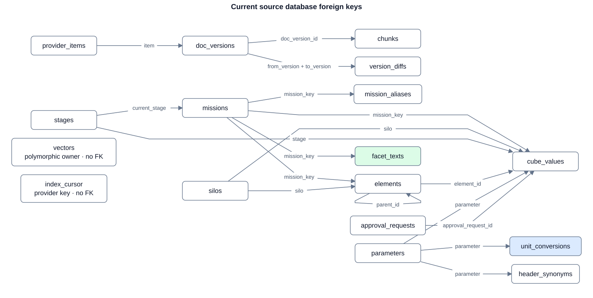

# Identity table reference

The current main application declares 34 PostgreSQL tables through 15 Alembic migrations. This reference describes declared schema, not a live database inspection. [Identity and workspace ownership](identity.md) records decision IAM-01 and the migration/test sequence.

## Accounts, conversations and personal ownership

| Table | Key and relationship | Responsibility |
|---|---|---|
| `users` | UUID PK; unique lowercase username | Durable local identity, display name and disable state |
| `local_credentials` | User PK/FK | At most one local password hash per user |
| `user_roles` | `(user_id, role)` PK; user FK | Current `member`/`admin` grants |
| `auth_sessions` | UUID PK; user FK; unique token digest | Expiring, revocable browser login |
| `workspace_tokens` | UUID PK; user FK; unique 32-byte token digest | Account-scoped HTTP read credentials |
| `mission_grants` | UUID PK; user FK; unique user/mission/silo | Source access; mission/silo strings do not have catalog FKs |
| `conversations` | UUID PK; owner FK | Chat title, timestamps and archive state |
| `messages` | UUID PK; conversation FK; optional run FK; unique conversation/sequence | Append-only history |
| `agent_runs` | UUID PK; conversation and starter FKs | Run status and temporary MCP credential |
| `agent_sessions` | Conversation PK/FK | Saved agent framework state |
| `approval_requests` | UUID PK; run, conversation and requester FKs | Frozen operation, arguments and digest |
| `approval_events` | UUID PK; request FK; optional actor FK | Append-only decisions and execution consumption |
| `call_log` | Numeric PK; correlation IDs without FKs | Operation metadata and outcome, including workspace-token ID |
| `workspace_files` | UUID PK; conversation FK; optional export-approval FK | SQL chat attachments and generated charts; not Jupyter personal files |
| `notes` | UUID PK; owner FK; optional conversation FK | Existing owner-scoped note API |
| `drafts` | UUID PK; owner, optional parent/approval FKs | Declared draft storage |
| `skills` | UUID PK; owner FK; unique ID/owner | Existing database saved-skill API |
| `skill_revisions` | Skill/revision PK; composite skill/owner FK; unique owner/mutation ID | Owned immutable saved-skill revisions |

The current [account diagram](../spec/images/identity-current.svg) shows the core FKs. The database enforces the skill/revision owner pair. Other independent owner/conversation/run FKs require service checks to prevent scope mismatch. A primary key identifies a row; it grants no request permission.

## Source library and datacube

Personal files and their skills are not stored or embedded in these source tables.

| Table | Key and relationship | Responsibility |
|---|---|---|
| `provider_items` | Source item PK; mission/silo/stage strings without FKs | Source catalog and withdrawal state |
| `doc_versions` | UUID PK; item FK; unique item/version | Indexed source version, hash and summary |
| `chunks` | UUID PK; cascading version FK; unique version/block | Derived searchable source blocks |
| `vectors` | UUID PK; polymorphic owner kind/ID without FK | Derived chunk/version/facet embeddings |
| `version_diffs` | From/to/sequence PK; cascading version FKs | Derived version comparisons |
| `index_cursor` | Provider PK | Source indexing progress |
| `silos` | Vocabulary key PK | Controlled source domain |
| `stages` | Vocabulary key PK | Controlled source lifecycle stage |
| `missions` | Mission key PK; current-stage FK | Source mission |
| `mission_aliases` | Alias PK; mission FK | Mission lookup names |
| `elements` | UUID PK; mission, silo and optional parent FKs | Mission/silo-specific element |
| `parameters` | Parameter key PK | Quantity, units and validity range |
| `unit_conversions` | Parameter/unit PK; parameter FK | Quantity unit conversion |
| `header_synonyms` | Header/parameter PK; parameter FK | Table-header recognition |
| `cube_values` | UUID PK; mission/silo/stage/element/parameter/approval FKs | Accepted observations with source provenance |
| `facet_texts` | UUID PK; mission FK; unique mission/facet | Derived mission-facet text and source references |

Arrows name actual FK columns. `vectors` owner references, `facet_texts` source arrays and cube item/version/block provenance are not FK-enforced. Their consistency and deletion need explicit source-index handling; the diagram does not imply authorization or semantic accuracy.

## Outside the current SQL schema

| Component | Current authority | Planned relationship |
|---|---|---|
| Personal workspace | Trusted private user-to-service configuration | Stable `workspaces.owner_user_id → users.id`, unique owner and storage reference |
| Scripts, notebooks, Markdown skills and outputs | Owner's Jupyter Contents API and durable `USER_ROOT` volume | Remain workspace contents; optional identity/revision catalog when required |
| Container, kernel and native bridge binding | Configured service and in-process runtime state | Workspace-owned runtime/lease when concurrent controllers require it |
| Executable tools | Code operation registry | Reuse registry; store only necessary user/workspace grants or connector metadata |
| External MCP connection credentials | Private service configuration | Workspace-owned connection with protected secret reference and lifecycle |
| External login | Deferred | User-owned unique issuer/subject link when OIDC is introduced |

The independent SQLite data-provider, runtime and Python-workspace prototypes are not the main PostgreSQL migration set. A prototype table is not evidence that a main application relationship exists.

Schema sources: [shared metadata](https://github.com/mchdeore/CRAFT/blob/main/app/infrastructure/database/metadata.py), [accounts](https://github.com/mchdeore/CRAFT/blob/main/app/accounts/storage.py), [conversations](https://github.com/mchdeore/CRAFT/blob/main/app/conversations/storage.py), [agent](https://github.com/mchdeore/CRAFT/blob/main/app/agent/storage.py), [approvals](https://github.com/mchdeore/CRAFT/blob/main/app/approvals/storage.py), [audit](https://github.com/mchdeore/CRAFT/blob/main/app/infrastructure/operations/storage.py) and [migrations](https://github.com/mchdeore/CRAFT/tree/main/migrations/versions).
